# BÁO CÁO BÀI TẬP THỰC HÀNH LẬP TRÌNH C# WINFORMS - KẾT NỐI CƠ SỞ DỮ LIỆU SQL SERVER

## I. THÔNG TIN SINH VIÊN
- **Họ và tên:** Lê Quang Hưng
- **Mã số sinh viên:** 24810320237
- **Lớp:** D19QTANM1
- **Môn học:** Lập trình .NET / Windows Forms
- **Tên bài tập:** Bài 6.3, 6.4 và 6.5 — Quản lý công việc, Garage và Karaoke

---

## II. THÔNG TIN HỆ THỐNG & CƠ SỞ DỮ LIỆU
- **Hệ quản trị CSDL:** Microsoft SQL Server Express (`localhost\\SQLEXPRESS`)
- **Cơ sở dữ liệu:** `ProjectTaskDB`, `GarageDB`, `KaraokeDB`
- **Công nghệ / Thư viện:** C# Windows Forms, .NET 10, ADO.NET (`Microsoft.Data.SqlClient`)
- **Mô hình phân lớp:** DTO, DAL, BUS và GUI
- **Môi trường phát triển:** Visual Studio 2026

---

## III. CÁC TÍNH NĂNG ĐÃ HOÀN THÀNH

### Bài 6.3 — Hệ thống quản lý công việc và tiến độ dự án
1. **Quản lý dự án và thành viên:** Thêm, cập nhật và xóa dự án; nạp thành viên từ SQL Server.
2. **Quản lý công việc:** Tạo task, đặt hạn nộp và ưu tiên, giao cho nhiều thành viên, lọc theo dự án và trạng thái.
3. **Truy vấn an toàn:** Cập nhật trạng thái bằng truy vấn có tham số; không ghép dữ liệu người dùng trực tiếp vào câu SQL.
4. **Báo cáo:** Liệt kê task trễ hạn bằng `SqlDataReader` và tổng hợp tỷ lệ hoàn thành theo thành viên bằng `GROUP BY`.

### Bài 6.4 — Hệ thống quản lý Garage và sửa chữa ô tô
1. **Quản lý chủ xe, xe và phụ tùng:** Thêm, cập nhật, tra cứu theo biển số và theo dõi tồn kho.
2. **Lập phiếu sửa chữa:** Ghi phiếu cùng các phụ tùng sử dụng trong một `SqlTransaction`.
3. **Kiểm soát tồn kho:** Trừ kho khi lập phiếu; nếu số lượng không đủ thì rollback toàn bộ giao dịch.
4. **Thanh toán và báo cáo:** Chuyển trạng thái phiếu sang đã thanh toán, tổng hợp số phiếu và doanh thu.

### Bài 6.5 — Hệ thống quản lý phòng Karaoke
1. **Sơ đồ phòng:** Hiển thị phòng trống và phòng đang hát bằng màu sắc; mở phòng tạo hóa đơn.
2. **Quản lý dịch vụ:** Thêm, cập nhật danh mục dịch vụ và tồn kho.
3. **Gọi dịch vụ:** Chỉnh sửa chi tiết bằng `DataTable` và đồng bộ xuống CSDL bằng `SqlDataAdapter` / `SqlCommandBuilder`.
4. **Thanh toán:** Tính tiền phòng theo thời gian, trừ tồn kho và trả phòng trong một `SqlTransaction`; thiếu tồn kho thì rollback.
5. **Báo cáo:** Xem hóa đơn, trạng thái thanh toán và chi tiết dịch vụ.

---

## IV. HÌNH ẢNH MINH HỌA KẾT QUẢ

### Bài 6.3 — Quản lý công việc và tiến độ dự án
#### 1. Màn hình chính / Tổng quan
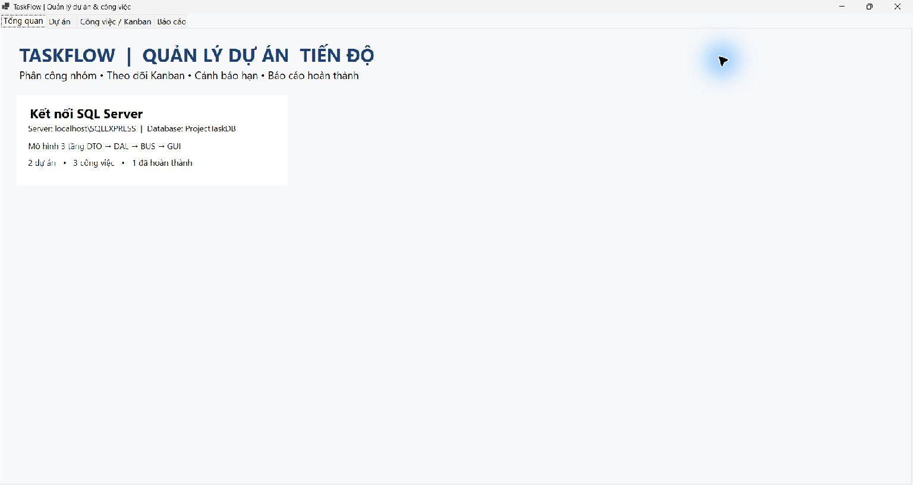
*Minh họa: Kết nối `ProjectTaskDB` và số liệu tổng quan dự án.*

#### 2. Màn hình quản lý danh mục / CRUD
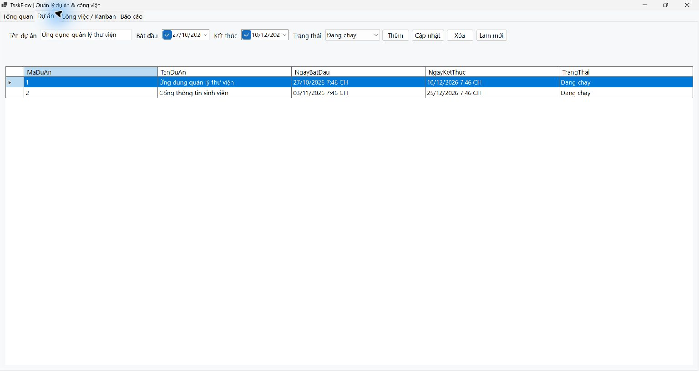
*Minh họa: Danh sách dự án và các thao tác quản lý.*

#### 3. Màn hình thực thi nghiệp vụ chính
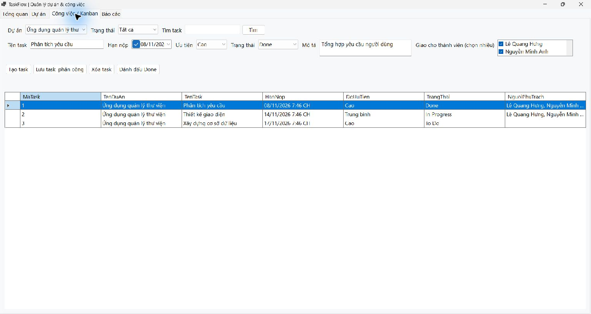
*Minh họa: Danh sách task, trạng thái và phân công thành viên.*

#### 4. Màn hình báo cáo - thống kê
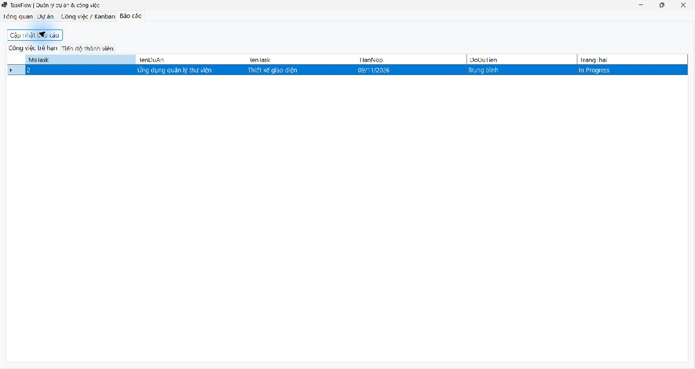
*Minh họa: Task quá hạn được truy vấn từ SQL Server.*

#### 5. Minh họa xử lý an toàn / lỗi
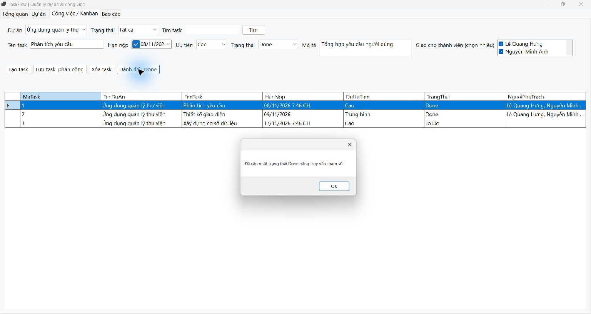
*Minh họa: Cập nhật trạng thái task bằng truy vấn tham số.*

### Bài 6.4 — Quản lý Garage và sửa chữa ô tô
#### 1. Màn hình chính / Tổng quan
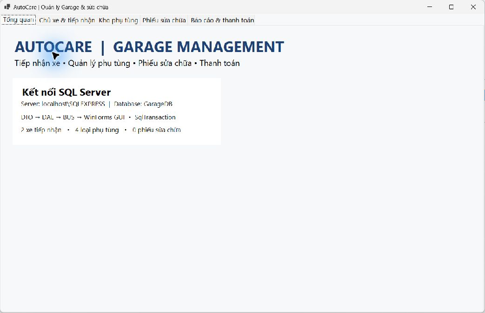
*Minh họa: Kết nối `GarageDB`, số xe, phụ tùng và phiếu sửa chữa.*

#### 2. Màn hình quản lý danh mục / CRUD
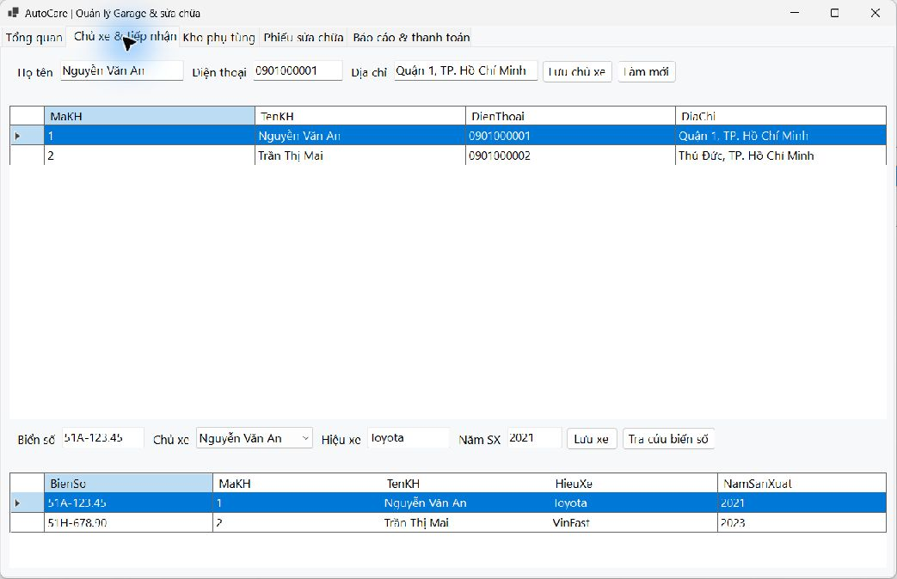
*Minh họa: Quản lý chủ xe và phương tiện.*

#### 3. Màn hình thực thi nghiệp vụ chính
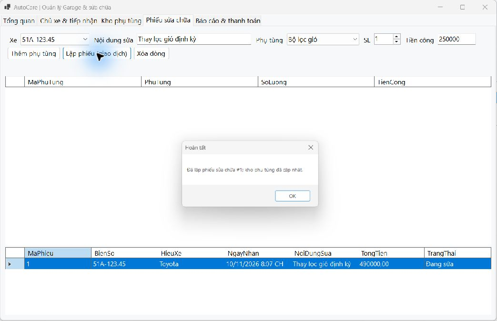
*Minh họa: Lập phiếu sửa chữa, ghi chi tiết và cập nhật kho bằng giao dịch.*

#### 4. Màn hình báo cáo - thống kê
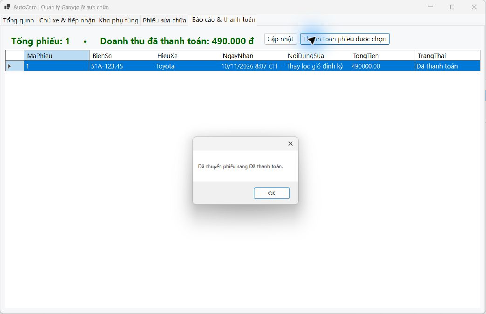
*Minh họa: Phiếu sửa chữa và doanh thu sau thanh toán.*

#### 5. Minh họa báo lỗi giao dịch / Rollback
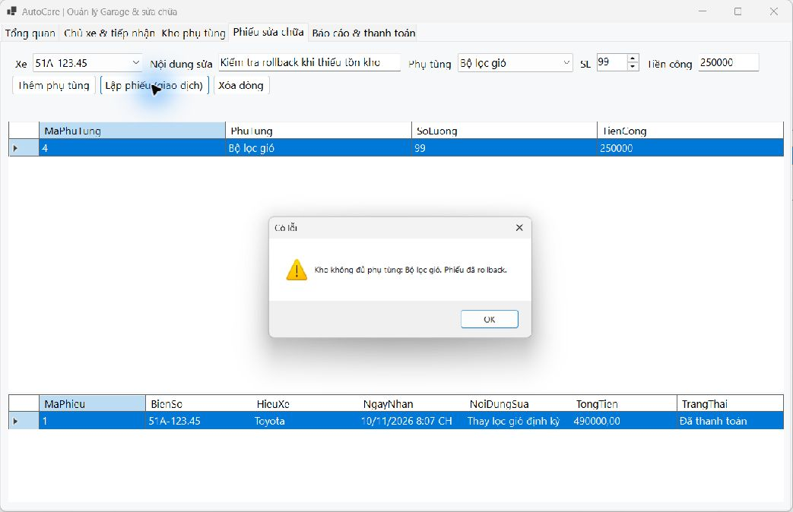
*Minh họa: Kho không đủ phụ tùng; giao dịch được rollback.*

### Bài 6.5 — Quản lý phòng Karaoke
#### 1. Màn hình chính / Tổng quan
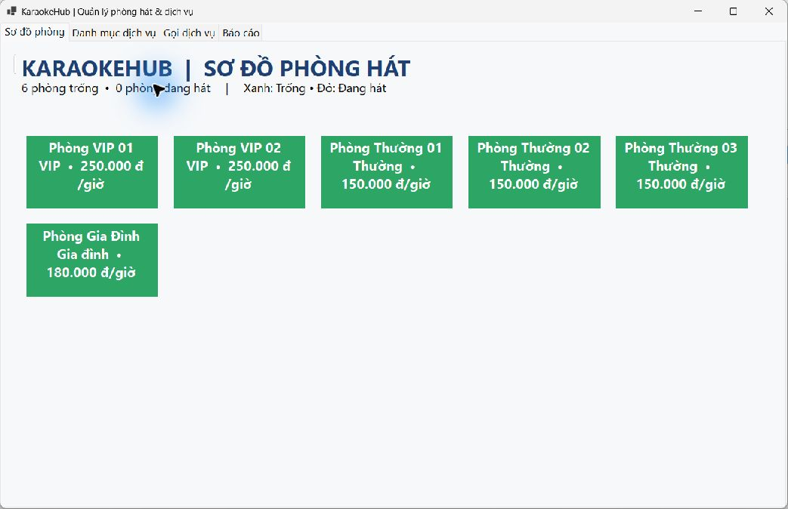
*Minh họa: Sơ đồ phòng trống và trạng thái phòng.*

#### 2. Màn hình quản lý danh mục / CRUD
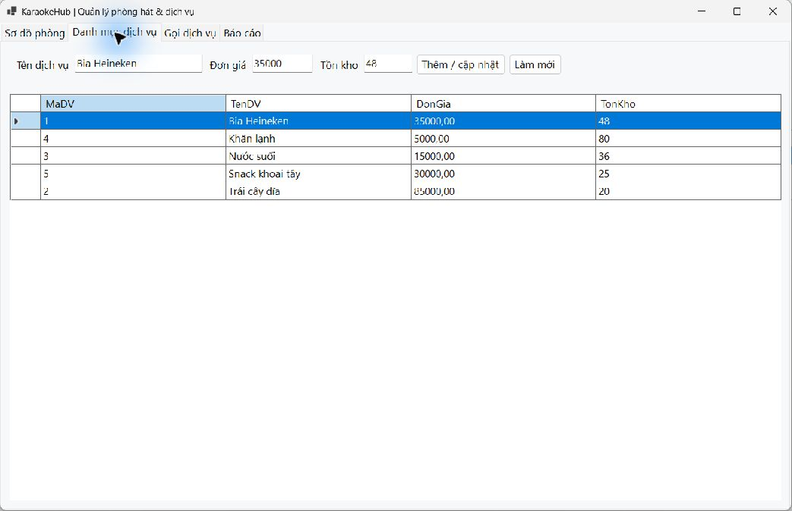
*Minh họa: Danh mục dịch vụ, đơn giá và tồn kho.*

#### 3. Màn hình thực thi nghiệp vụ chính
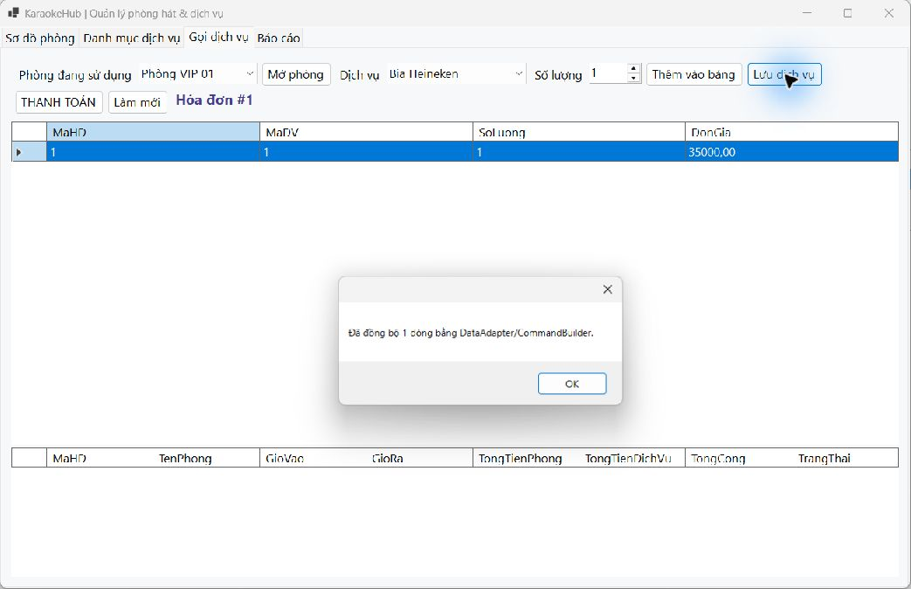
*Minh họa: Gọi dịch vụ và lưu chi tiết hóa đơn xuống CSDL.*

#### 4. Màn hình báo cáo - thống kê
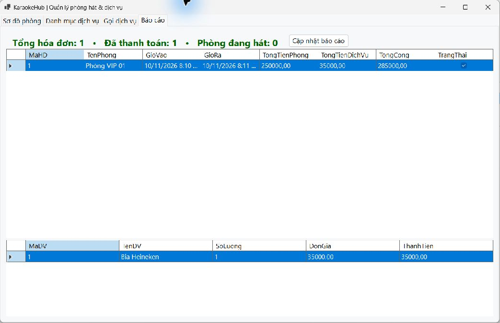
*Minh họa: Hóa đơn đã thanh toán và chi tiết dịch vụ.*

#### 5. Minh họa báo lỗi giao dịch / Rollback
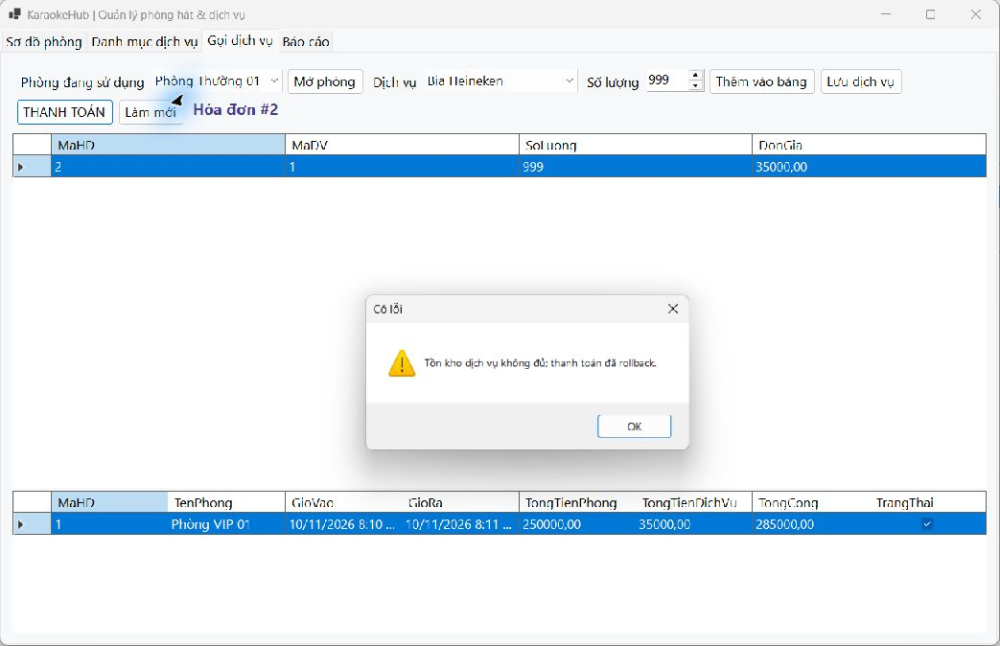
*Minh họa: Tồn kho dịch vụ không đủ; thanh toán được rollback.*

---

## V. CẤU TRÚC REPOSITORY
```text
LTNET-10-11-2026_24810320237_LeQuangHung/
├── .gitignore
├── README.md
├── Database/
│   ├── ProjectTaskDB.sql
│   ├── GarageDB.sql
│   └── KaraokeDB.sql
├── images/
│   ├── Bai6.3/  (05 ảnh minh họa)
│   ├── Bai6.4/  (05 ảnh minh họa)
│   └── Bai6.5/  (05 ảnh minh họa)
└── src/
    ├── LTNET-10-11-2026_24810320237_LeQuangHung.sln
    ├── ProjectTasks/
    ├── GarageManager/
    └── KaraokeManager/
```
File `.gitignore` loại trừ `.vs/`, `bin/`, `obj/` và các file người dùng do Visual Studio tạo ra.

---

## VI. HƯỚNG DẪN CÀI ĐẶT & CHẠY
1. Mở SQL Server Management Studio và kết nối `localhost\\SQLEXPRESS` bằng Windows Authentication.
2. Chạy lần lượt `Database/ProjectTaskDB.sql`, `Database/GarageDB.sql` và `Database/KaraokeDB.sql` để tạo CSDL cùng dữ liệu mẫu tiếng Việt.
3. Mở `src/LTNET-10-11-2026_24810320237_LeQuangHung.sln` trong Visual Studio 2026.
4. Chọn `ProjectTasks`, `GarageManager` hoặc `KaraokeManager` làm Startup Project rồi nhấn **F5**.
5. Nếu SQL Server dùng instance khác, sửa `ConnectionString` trong thư mục `DAL` của dự án tương ứng.
